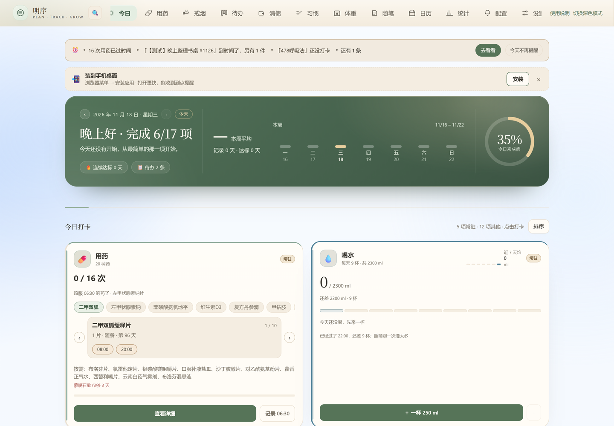
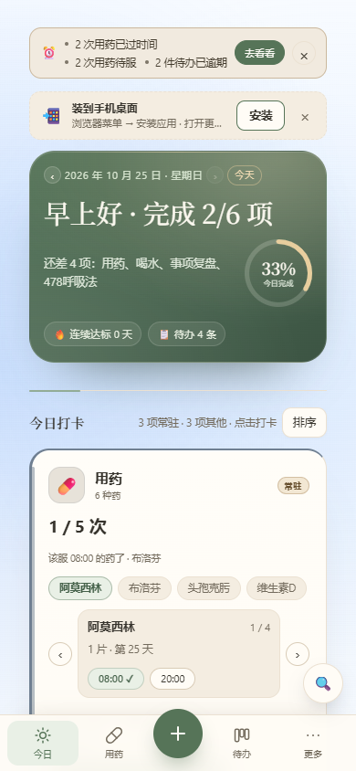

# 晚风 Todo

[](https://github.com/sl818/wanfeng-todo/actions/workflows/check.yml)
[](LICENSE)

> 一个可自托管的个人生活仪表盘：**习惯打卡、用药记录、待办看板、体重、随笔、日历回顾、统计复盘**，
> 外加一个独立的「清债」模块。多设备共用一份云端数据，能装成手机 App（PWA），
> 到点通过企业微信把提醒推到手机。

前端是**一个 `index.html`**——零构建、零依赖、零 CDN；后端是**无框架的 PHP + MySQL**。
没有 npm、没有打包步骤：改完保存刷新就能看到效果，部署时把文件传上去就行。



<p align="center">
  
</p>

**特性一览**

- 11 个页面：今日 / 用药 / 待办 / 清债 / 习惯 / 体重 / 随笔 / 日历 / 统计 / 配置 / 设置
- 6 套主题 × 明暗、3 种布局、手机底部导航、键盘命令面板（`Ctrl/⌘ + K`）
- 云端多账号：邀请码注册、单设备登录、`base_rev` 乐观锁合并、历史版本回滚
- 企业微信机器人推送（待办 / 用药 / 通知 / 倒数日 / 还款日）+ ICS 日历订阅
- 全站 JSON 导出 / 导入，数据始终在你自己的库里
- 无框架、无构建、无 CDN，单文件前端约 1.4 万行

> 除了本文件，其余文档都在 [`docs/`](docs/README.md) 目录。

- 部署步骤看 [DEPLOY.md](docs/DEPLOY.md)
- 技术结构看 [ARCHITECTURE.md](docs/ARCHITECTURE.md)（分册：[FRONTEND](docs/FRONTEND.md) / [BACKEND](docs/BACKEND.md) / [DATA-MODEL](docs/DATA-MODEL.md)）
- 版本流水看 [HANDOFF.md](docs/HANDOFF.md)
- 写新皮肤看 [THEME-SPEC.md](docs/THEME-SPEC.md) / [AI-THEME-GUIDE.md](docs/AI-THEME-GUIDE.md)
- 全部文档索引看 [docs/README.md](docs/README.md)

---

## 快速开始

1. 按 [DEPLOY.md](docs/DEPLOY.md) 部署到自己的服务器。
2. 打开域名，先看到功能介绍页；点「登录」或「注册（需要邀请码）」。
3. 注册密码至少 8 位；忘记密码点登录框右下角「找回密码」，按提示联系管理员。
4. 登录后进入看板，修改自动保存到云端。
5. 在浏览器菜单里选「安装应用 / 添加到主屏幕」，装成 PWA。
6. 想在手机上收到提醒，去 **设置 → 手机推送** 填企业微信机器人地址（见下文「手机推送」）。

---

## 页面

十一个页面。桌面侧栏全部可见，顺序是：

```
今日 · 用药 · 待办 · 清债 · 习惯 · 体重 · 随笔 · 日历 · 统计 · 配置 · 设置
```

手机底部只有 4 个高频道 + 中间悬浮「＋」：

```
[今日] [用药] [＋] [待办] [更多]
```

「更多」点开是贴底抽屉，列着清债、习惯、随笔、体重、日历、统计、配置，任何页面两步可达。

---

### 今日：今天该做什么

- **日期条**：`‹` `›` 回看并补记之前的日子，不能翻到未来；不在今天时显示「回到今天」。
- **顶部圆环**：当天完成度；旁边是连续达标天数和未完成待办数。
- **常驻四卡**（固定在最上面）：
  - **用药**：汇总今天所有药，显示已服 / 应服、下一次服药时间或「该吃药了」、库存不足提醒。
    「记录 08:00」直接记下一次，「全部」打开当日用药清单。清单按药分组，每个时间一个按钮，
    已服的可以再点撤销；按需药单独一行，可多次记录。**两种以上药时卡片变成轮播**，
    左右箭头切换，一次看一种。
  - **喝水**：当前杯数 / 目标、还差几杯、上次喝水时间；「＋ 喝一杯」或「−」撤销。
    卡片还带近 7 天迷你柱、24 小时分布条和节奏建议。
  - **运动**：完成状态、连续天数；「完成运动」或撤销。带周视图和七段环。
  - **478 呼吸法**：吸气 4 秒 → 屏息 7 秒 → 呼气 8 秒，完整一轮计一次；
    不设目标，不计入完成率。开始后按钮变「进行中」并禁用，完成后变「再来一次」。
- **其他习惯**：目标 ≤ 6 次用点阵（点刻度直接设次数），> 6 次用加减器；
  戒除型显示「保持中 / 已记录 N 次」，点「记一次」记录破戒。
- **今日待办**：列出「进行中」或「截止日期不晚于当天」的未完成任务；勾选完成，✎ 编辑。
  超过 6 条会折叠，点「展开全部」。已完成的单独分组。
- **快速添加**：底部输入框回车即建一条待办，默认分类「生活」、优先级「中」、
  截止日期为当前选中的日期。
- **页面底部**：本周节奏条（每天完成度、平均、达标天数）和「今日状态」
  （😞 不开心 / 😐 正常 / 😄 开心）；再点一次已选心情可取消。

补记模式下标题会显示「补记」，所有打卡都记到选中的日期。

> 宽屏（wide 布局）下今日页是两栏：主列 + 右栏（本周概览、下一次用药提醒、同步状态）。

---

### 用药：管理与记录

页面顶部两个按钮：**记录用药**、**盘点库存**。

- **分组**：进行中 / 未开始 / 暂停 / 已停用。进行中组内再按疗程切三段：长期 / 短期 / 按需。
  组内排序是「餐前 → 随餐 → 空腹 → 餐后 → 未设置」，同组按第一个服药时间。
- **一行一种药**，主信息是「每天几次 / 每次几颗 / 餐前餐后多久」（这是最该被看见的内容），
  次要信息是用途、厂商、疗程进度。
- **按需药**行内直接给「＋ 记一次」，不必进弹层。

**药品字段**：药名、用途、剂型、规格、每次剂量与单位、服药时间（按次数动态排）、
用餐时机与间隔、疗程类型、开始 / 结束 / 复查日期、状态、库存、厂商、药品说明、备注。

**三种疗程类型的行为差异**：

| | 长期 | 短期 | 按需 |
|---|---|---|---|
| 需要设时间 | 是 | 是 | 否 |
| 需要结束日 | 否 | **是（必填）** | 否 |
| 进日历 | 是 | 是（到结束日） | 否 |
| 发推送 | 是 | 是 | 否 |
| 计入依从率 | 是 | 是 | 否（只报次数） |
| 扣库存 | 是 | 是 | 是 |

**库存怎么算**：不是存「还剩多少」，而是「基线 − 之后所有服药记录」。
每次点「盘点库存」填「现在手里有多少」，就把此刻设为新基线，余量从这一刻重新推算。
好处是撤销服药记录时余量会自动退回，不会越算越歪。

---

### 待办：任务流

- 四列：**待办 → 进行中 → 已完成 → 已取消**，列头显示数量。
- 电脑上拖动卡片换列、同列调整顺序；手机上用卡片上的 `←` `→`。
- 在列的空白处右键新建该列任务；在卡片上右键编辑。已取消列不响应右键。
- 双击卡片展开详情（备注全文 + 元信息）。
- 卡片可设分类、优先级、截止日期、备注；过期标红；已取消可一键恢复。
- **分类**取值：健康 / 生活 / 工作 / 学习 / 其他。**优先级**：高 / 中 / 低。
- **截止日期快捷**：编辑表单里「明日 / 三日」两个按钮，点一下自动填日期。

**重复任务**：单次 / 每天 / 每周 / 每月。每周可选星期几；每月可选 1–31 号，
遇到小月自动取当月最后一天。重复任务完成后会在待办列自动生成下一次任务，
撤销完成会移除尚未完成的下一件。

**时间块**（可选，没有也能用）：

| 字段 | 默认 | 说明 |
|---|---|---|
| 开始时间 | 空 | 填了就在周视图里画成色块 |
| 时长 | 不设 | 30 分钟 / 1 小时 / 1.5 小时 / 2 小时 / 3 小时 |

填了开始时间但没动通知时间，通知时间会自动跟着开始时间走——下午的事不会早上 9 点响。
想提前提醒（比如 13:45 提醒 14:00 的会），手动改一下通知时间就行，两个字段是独立的。

**通知设置**（每个待办独立）：

| 字段 | 默认 | 说明 |
|---|---|---|
| 是否通知 | 是 | 关掉就完全不推 |
| 通知时间 | 09:00 | 到点推 |
| 通知备注 | 空 | 可选，随推送一起发 |

**注意**：只有「截止日期正好是今天」的待办才会按点推送。逾期的不会反复响
（走页内横幅提醒），未来的只会在到期那天推。

「清理已完成」会**永久删除**所有已完成任务，操作前会确认；已生成的下一件重复任务仍保留。

---

### 习惯：管理习惯与通知

- **我的习惯**：增删改图标、名称、类型、目标次数、单位、颜色、备注。
- **常驻规则**：喝水、运动、478 呼吸不能删除；用药是独立的常驻卡，
  具体药物在「用药」页维护；478 呼吸不设目标，只累计练习次数。
- **习惯类型**：
  - 养成：每天完成 N 次。
  - 戒除：每天保持 0 次；不点「记一次」就算保持。
- **归档**：自定义习惯可以归档，归档后不出现在今日、日历和统计里，但历史打卡保留；
  可在「已归档」里恢复或永久删除。常驻习惯不能归档。
- **排序**：按创建 / 今日进度 / 连续天数，离开页面后仍保留。

**通知设置**（每个习惯独立）：

| 字段 | 默认 | 说明 |
|---|---|---|
| 通知开关 | 开 | 关掉就完全不推 |
| 通知时间 | 15:00 | 到点推 |
| 通知频率 | 每天 | 每天 / 每周 / 每月 |
| 每周几 / 每月几号 | — | 选了「每周」或「每月」才出现 |
| 通知备注 | 空 | 可选，随推送一起发 |

**关键点：通知频率不影响打卡频率。** 打卡该每天还每天，只是提醒可能每周才来一次。

例如「称体重」：通知=开、频率=每周、每周一、时间 08:25、备注「早上如厕后空腹称更准」。
这样每周一提醒一次，但这一周里你随时都能打卡。

当天已经打过卡的习惯，到点不会催。

---

### 体重：身体档案与 BMI

- 先建立「身体档案」：年龄、身高（cm）、可选目标体重；只需要维护一次。
- 点「记录体重」只填日期和体重；BMI 自动计算并实时预览。
- BMI = 体重(kg) ÷ 身高(m)²；成人参考范围 18.5–23.9，未成年人仅参考。
- 同一天再次记录会更新当天数据，不会产生重复。
- 页面显示最新体重、BMI、较上次 / 累计变化、折线趋势图（带健康区间背景带和目标虚线）
  和全部记录。
- 折线图可切区间，跟随页面顶部的范围选择。
- 日历里会显示体重小圆点和当天体重 / BMI；统计页「体重与 BMI」跟随时间范围切换。

---

### 随笔：随手记

- 点「写一篇」填写日期、可选标题、正文，最多 5000 字。
- 可加最多 5 个标签（用逗号分隔），每个标签最多 12 字。
- 卡片显示日期、字数、标题、摘要和标签；可编辑或删除。
- 顶部可以按标签筛选。

---

### 日历：月视图与周视图

顶部可以切 **月 / 周** 两种视图。

**月视图（回看每一天）**

- 从周一开始；颜色越深完成度越高，完成率 ≥ 75% 记为达标日。
- 每个格子里：日期、当天到期的待办、完成度百分比、当天心情。
  桌面上显示最多 2 条待办标题（超出显示 `+N`），手机上显示「N 项」。
- 日期右下角显示当天心情；今天右上角有金点标记。
- 点任意过去 / 今天跳到今日页补记；未来日期不可点。

**周视图（看每天几点有什么事）**

- 0:00–24:00 的时间线，每小时一格；打开时自动滚到当前时刻附近。
- 待办、用药、习惯都按各自的时间点画成色块：
  - 填了「开始时间」的待办画成真实长度的块（如 14:00–15:30）
  - 没填时间的待办进顶部「全天」行
  - 用药每个服药时刻画 15 分钟，习惯画 30 分钟
- **同一时刻同类型的条目会合并成一块**，比如「用药 ×11」——点开能看清单。
  不合并的话 08:00 十一个药会挤成十一条线，什么也看不清。
- 今天那一列有底色和一条红色当前时刻线。
- 手机上整周横向滑动查看（会提示「左右滑动可看完整一周」）。

**底部三卡**（两种视图都有）：本月小结 / 本月心情 / 本月体重。
翻到别的月份时它们跟着变。

> 原来的「本月习惯」「本月用药」已移到**统计页**——它们本质是月度汇总，
> 和「看哪一天发生了什么」无关，留在日历页只会挤占时间线的宽度。

**另外还有日历订阅**（设置 → 日历订阅）：生成一个 `.ics` 地址，
加到手机系统日历里，到点由系统自己提醒。详见下文「两种提醒方式的区别」。

---

### 统计：只看趋势

- 四张卡：连续达标、所选范围完成率、本月完成率、已完成任务数。
- 顶部可切换 **近 7 / 30 / 90 天**，默认 30 天。
- 完成率柱状图、习惯点阵、用药记录、体重趋势都会跟随所选范围。
- **用药依从趋势**：每天一根柱，高度 = 当天已服 ÷ 应服。那天没药的显示空柱（不是 0%）。
  头部是区间百分比 + 与上月同期对比。浅色柱表示低于 80%。
- **本月回顾**：本月整体怎么样，六格数据 + 一句话结论。
- **月度健康小结**：点「生成月度小结」打开一张可打印的卡片——用药依从明细
  （每种药的应服 / 已服 / 依从率，按依从率从低到高排，最需要关注的在前）、
  体重变化、习惯完成率、记录情况。点「打印 / 存为 PDF」可以存成 PDF 给医生看。
  备用药单独列，只报「这个月吃了几次」（它不排期，给依从率是误导）。
- 只统计「有记录的日子」，没打开应用的日子不拉低完成率。

---

### 设置：外观、账号、数据、推送

- **外观**：9 套皮肤，每套都有浅色 / 深色。
  **三种 PC 布局**：顶部 / 侧栏 / 宽屏。
  明暗默认「自动」：7:00–19:00 浅色，其余深色；也可手动固定。
- **账号与同步**：登录、邀请码注册、修改密码、管理员用户管理；
  右下角常驻保存状态：待保存 / 保存中 / 已保存时间 / 保存失败，点击可立即保存。
- **手机推送**：见下文。
- **日历订阅**：见下文。
- **数据管理**：历史版本、导出 JSON 备份、导出 CSV、清空全部数据。
- **历史版本**：每次保存 / 清空 / 恢复前存快照，保留最近 20 版 / 30 天；
  只对当前用户可见，可预览和恢复。
- **CSV 导出**：列为「日期、类型、名称、数值、单位、标签、详情」，包含所有习惯打卡、
  实际用药记录、体重、心情和随笔；对以 `= + - @` 开头的用户输入加前缀，避免 Excel 公式注入。

---

## 手机推送（企业微信机器人）

这是真正能在手机上收到提醒的方式，**关掉网页也会响**。

### 两种提醒方式的区别

| | 日历订阅 | 手机推送 |
|---|---|---|
| 谁在算 | 手机系统日历自己算 | 服务器每分钟算一次 |
| 需要服务器 | 只要地址 | 需要定时任务 |
| 关掉网页 | 照常提醒 | 照常提醒 |
| 消息内容 | 日历事件标题 | 纯文本，能说清"该吃哪个药" |
| 国产安卓 | 小米等日历解析不了订阅源 | 可用 |

### 怎么配

**第一步：拿企业微信机器人地址**

1. 手机装企业微信，注册一个企业（免费，不需要营业执照，企业名随便填）。
   **账号类型选「企业」**，这样后面能绑到个人微信。
2. 通讯录 → 右上角 `+` → 创建群聊 → **内部群**（外部群加不了机器人）。只加自己一个人就行。
3. 进群 → 右上角 `···` → 群设置 → 群机器人 → 添加 → 起个名字 → 复制地址。

**第二步：填进设置页**

设置 → 手机推送 → 粘贴地址 → 点「保存并发一条测试」。手机收到就说明通了。

**第三步（建议）：绑到个人微信**

企业微信 → 我 → 设置 → 我的企业 → 微信插件 → 用个人微信扫码绑定。
之后消息会出现在个人微信的「企业微信联系人」里，不用专门开企业微信。

> 地址等于往你群里发消息的钥匙，别贴到公开的地方。万一泄露，
> 在企业微信里删掉机器人再重新添加一个就是新地址。

### 会推什么

| 类型 | 内容 |
|---|---|
| 用药 | 「该吃药了 / 阿莫西林 1片（每天 08:00）」 |
| 待办 | 「该做这件事了 / 交周报 + 备注 + 通知备注」 |
| 习惯 | 「🌬️ 478呼吸法 / 今天的习惯还没打卡 + 通知备注」 |
| 汇报 | 见下 |

**三时段待办汇报**（时间写死，不需要配）：

| 时间 | 内容 |
|---|---|
| 08:20 | 今日待办早报：未完成 X 项 · 逾期 Y 项 + 按分类分组（工作 2 项、生活 1 项…） |
| 12:30 | 待办进度午报：同上 |
| 20:00 | 今日小结：今日完成 X 项待办 / 明日待办 Y 条 |

「未完成」的口径是**所有没做完的待办**（含未来几天，不含已取消 / 已归档），
所以早报能一眼看到全局。

### 不会推的情况

| 情况 | 原因 |
|---|---|
| 备用药（按需服用） | 没有固定时刻 |
| 已停药的 | 状态不是「进行中」 |
| 还没到开始日 / 短期疗程已结束 | |
| **当天那个时段已经记录服药** | 吃过了就不催（提前吃也算） |
| 已完成 / 已取消 / 已归档的待办 | |
| **逾期的待办** | 不按点反复响，走页内横幅 |
| 关闭了通知开关的待办 / 习惯 | |
| 当天已打卡的习惯 | |
| 戒除型习惯、可选项习惯 | |

### 推送中心

设置页的「手机推送」区块下面还有两块：

- **今日推送计划**：列出今天所有会推的时间点和内容。配完就能一眼看出对不对，不用干等。
- **最近发送**：最近 10 条实际发出去的记录，带时间和正文。

---

## 日历订阅

设置 → 日历订阅 → 复制地址 → 加到手机系统日历（「通过 URL 添加日历」）。

- 地址形如 `https://你的域名/api.php?ics=xxxx.ics`
- **末尾的 `.ics` 不能删**，很多安卓日历靠它判断这是不是日历源
- 想换地址点「重置订阅地址」，旧地址立刻失效
- 订阅内容：用药、待办、习惯（只含有通知时间的）

**注意**：小米 / 华为等部分国产日历解析不了这种订阅源（同一份 ICS 用 Google 日历能正常读，
小米读出来是 0 条事件）。这类设备请用**手机推送**。

---

## 命令面板（Ctrl + K 或 Cmd + K）

同一个输入框，**认得出命令就执行，认不出就当搜索词**，所以老用法没变。

| 写法 | 作用 |
|---|---|
| `+1 喝水` / `-喝水` | 给习惯打卡（数字省略按 1） |
| `-1 看书` | 撤销一次 |
| `记 体重 68.5` / `68.5 体重` | 记录今天的体重（同日已有则更新） |
| `新任务 交报告 明天` | 新建待办，认 今天 / 明天 / 后天 / 大后天 |

认不出的习惯名一律退回搜索，不会报错。手机上是右下角的悬浮搜索按钮。

---

## 规则口径

| 规则 | 口径 |
|---|---|
| 完成率 | 当天达标习惯数 ÷ 当天启用的习惯数；用药当天没有计划时，用药习惯不计入分母 |
| 达标日 | 当天有记录，且完成率 ≥ 75% |
| 连续达标 | 从今天往前数；今天还没达标就从昨天开始数 |
| 戒除型 | 当天 0 次即达标；连续天数从习惯创建日累计，破戒当天中断，次日重新开始 |
| 用药依从 | 跟随统计页所选 7 / 30 / 90 天范围，只统计已经到时间的计划；按需用药不计入比例 |
| 无记录日 | 不参与完成率平均；连续达标按自然日计算，中间空白会中断 |
| 补记 | 改变那一天的完成率和日历，但操作时间仍是实际点击的时间，统计里会标「补记」 |

---

## 云端账号与数据

部署到自己的服务器（PHP + MySQL）后，访问域名会先进入安装向导：
填数据库、创建第一个管理员、生成邀请码。装完后的行为：

- **域名首页是功能介绍页**，未登录只能看介绍。
- 注册密码至少 **8 位**；注册需要管理员提供的邀请码。
- 忘记密码：登录框右下角「找回密码」提示联系管理员，由管理员在「用户管理」里重置。
- **数据只保存在服务器 MySQL**，每个账号一份，本地不保存完整 JSON。
- 管理员可以开关注册、更换邀请码、重置密码、停用 / 启用账号；
  接口不返回任何用户的看板数据，不能查看或导出别人的习惯、任务、用药记录。
- **单设备登录**：同一账号只允许一台设备在线。在别处登录，这台设备会被踢下线。
- 两台设备都改了同一份数据时，会**自动合并**而不是整份覆盖：
  新增的记录会合并到一起（打卡次数取较大值、服药记录按时段并集），不会丢。
- **不再支持离线打开**：断网或刷新后无法加载数据；已打开的页面可在内存中继续操作，
  但保存会失败。
- 支持 PWA：HTTPS 下可以「安装到桌面 / 添加到主屏幕」。

旧版本留在 `localStorage` 的 `lifeboard.v1` 数据，会在**云端为空时**于第一次登录自动上传一次。

---

## 数据与备份

- 云端数据保存在 MySQL 的 `boards.data` 里；浏览器只保留主题偏好和登录元信息。
- **JSON 导出**用于备份；**不支持导入**。
- **每日自动快照**：服务器每天把整站数据写一份到 `backups/`，保留 30 天。
  文件写成 `.php` 且首行是 `<?php exit; ?>`，所以放在站点目录里也不会被公网读取。
  恢复命令见 [DEPLOY.md](docs/DEPLOY.md)。
- 清缓存、换浏览器、换设备不会影响云端数据，但退出登录后需要重新登录。
- 「清空全部数据」会恢复初始示例习惯和默认用药，同时清空任务、打卡、心情、
  用药、体重和随笔记录，不可撤销。

---

## 兼容性与限制

- 需要较新的 Chrome / Edge / Safari / Firefox（样式用到 `color-mix` 等新特性），不支持 IE。
- 桌面端支持拖拽；手机端待办用 `←` `→` 按钮。
- **必须登录**；未登录只能看介绍页。
- 忘记密码只能由管理员重置。
- 主题默认按时间自动切换（7:00–19:00 浅色），也可手动固定。
- PWA 需要 HTTPS；只缓存页面外壳和图标，接口数据仍要联网。
- 只记录医生给的用药方案，不提供任何剂量建议。
- 操作日志最多保留 1000 条；单份数据上限由服务器配置控制（默认 2MB）。
- 企业微信限每个机器人每分钟 20 条，超出会静默丢弃。正常使用远远够。

---

## 文件结构

前端主体是 [`index.html`](index.html)，约 11,700 行；后端是 `api.php` + `api/`。

| 文件 | 内容 |
|---|---|
| [`index.html`](index.html) | 页面、全部样式、全部前端逻辑 |
| [`service-worker.js`](service-worker.js) | PWA 缓存策略 |
| [`manifest.json`](manifest.json) | PWA 清单 |
| [`themes/`](themes) | 5 套补充皮肤 + 主题模板 |
| [`api.php`](api.php) | 唯一接口入口（23 个 action） |
| [`api/bootstrap.php`](api/bootstrap.php) | 数据库、会话、CSRF、权限、限流 |
| [`api/ics.php`](api/ics.php) | 日历订阅（iCalendar 生成） |
| [`api/schedule.php`](api/schedule.php) | 算「某一天几点该提醒什么」 |
| [`api/push.php`](api/push.php) | 企业微信发送 + 推送调度 |
| [`api/backup.php`](api/backup.php) | 每日快照 |
| [`api/config.php`](api/config.php) | 安装器生成的配置（不要公开） |
| [`install/index.php`](install/index.php) | 安装向导 |
| [`db/schema.sql`](db/schema.sql) | 建表语句 |
| [`db/migrations/`](db/migrations) | 增量迁移 SQL |
| [`tools/`](tools) | 命令行工具：推送、诊断、补索引、恢复备份、建号 |
| [`e2e/`](e2e) | 测试脚本（后端单测、浏览器 E2E、对比度审计） |
| [`icons/`](icons) | PWA 图标 |
| [`_check_script.mjs`](_check_script.mjs) | 内联脚本与 `data-act` 自检 |

**详细的内部结构**（六个 `<style>` 块各管什么、106 个交互怎么分发、23 个接口的鉴权）
请看 [ARCHITECTURE.md](docs/ARCHITECTURE.md)。

改完代码跑一次自检（需要 Node.js）：

```bash
node _check_script.mjs
```

它会校验所有内联 `<script>` 的语法、把 `data-act` 和 `ACTIONS` 表对比报告缺失处理器。
对只在运行时拼接的 `med-take` / `med-undo` 会提示「可能为动态」，属正常。

---

## 常见问题

**Q：数据到底存在哪？会丢吗？**

保存在你自己服务器的 MySQL（`boards.data`）；浏览器只保留主题偏好和登录元信息。
服务器每天自动快照到 `backups/`，保留 30 天。数据库本身也建议定期备份。

**Q：断网还能用吗？**

不能重新加载数据。已经打开的页面可以在内存里继续操作，但保存会失败；
刷新或重新打开会停在介绍页。请保持网络，离开前确认显示「已保存」。

**Q：换手机怎么把数据带过去？**

新设备登录同一账号即可从云端加载，不需要导入。JSON 导出只作为额外备份，导入功能已取消。

**Q：吃药会有提醒吗？**

会。配好企业微信机器人后，到点会推到手机（关掉网页也响）。见「手机推送」。
如果没配推送，今日页只会显示「该吃药了」，不会响。

**Q：为什么 8:00 的药没提醒？**

先看三种可能：① 那个时段你已经记录服药了（吃过了不催）；② 药是「按需服用」类型；
③ 服务器上的定时任务没在跑。设置页「今日推送计划」能一秒看出前两种。

**Q：支持多台设备同时编辑吗？**

支持，而且会合并。两台设备各自改了不同内容，保存时会自动合并
（打卡次数取较大值、服药记录按时段并集、待办和习惯按 id 并集），不会整份覆盖。
但同一账号只允许一台设备在线，在别处登录这台会被踢下线。

**Q：管理员能看到我的数据吗？**

不能。管理员接口只返回账号字段，没有任何读取 `boards` 的接口，也不能导出用户数据。
但管理员可以重置密码，理论上可以设置新密码后以该用户身份登录——这是
「管理员可重置密码」的固有边界。

**Q：为什么今天完成率不是 100%？**

看当天所有启用的习惯；用药要等所有计划次数都记录完，戒除型没破戒才算保持。
没记录的日子不计入完成率平均（但会中断连续达标）。

**Q：忘记打卡了怎么办？**

今日页用 `‹` 回看，或日历点那一天补记；统计里会标「补记」。

**Q：能删掉用药 / 喝水 / 运动吗？**

不能删这些常驻卡；但具体药物可以暂停或删除，喝水、运动和 478 呼吸可以改名称、
目标（478 呼吸不设目标）和颜色。

**Q：主题为什么自己变了？**

默认「自动」：7:00–19:00 浅色，其余深色。设置 → 外观里可以手动固定。

**Q：怎么注册？邀请码在哪？**

安装完成页会显示邀请码；管理员也可以随时在「设置 → 账号与同步 → 用户管理」里查看和更换。

**Q：安装向导提示数据库不是空的？**

安装器只支持全新空库。换一个空数据库，或把库里的表删掉再重试；它不会覆盖已有数据。

---

## 小建议

- 一次只跟踪 2–3 个习惯，坚持一周再加新的。
- 待办里同时进行的事不要超过 3 件。
- 晚上睡前花 10 秒补记，比追求完美更重要。
- 每月导出一次备份，换设备前再导出一次。
- 配好手机推送后，先把「今日推送计划」看一眼——确认它算得对，比等到点猜要省事。

---

## 技术栈

| 层 | 选型 |
|---|---|
| 前端 | 原生 HTML / CSS / JS，单文件 `index.html`（约 1.4 万行），无框架、无构建、无 CDN |
| 后端 | PHP 8 + PDO，无框架；`api.php` 单入口 + `api/*.php` |
| 数据库 | MySQL 5.7+ / 8（SQLite 只用于本机测试） |
| 同步 | 全量 JSON 快照 + `base_rev` 乐观锁 + `mergeStates` 合并 |
| 离线 | Service Worker 预缓存外壳，`api.php` 永远走网络 |
| 通知 | 企业微信机器人 Webhook + 每分钟 cron |
| 主题 | `themes/*.css` 只覆盖 CSS 变量与少量组件，切换不改 DOM 结构 |

## 目录结构

```text
index.html            前端全部（HTML + CSS + JS）
service-worker.js     PWA 外壳缓存，改前端必须递增 CACHE 版本
api.php               API 单入口（login / save / load / export …）
api/                  bootstrap / ics / push / schedule / backup
install/              安装向导（建表、建管理员、生成邀请码）
db/schema.sql         表结构；db/migrations/ 是增量迁移
themes/               6 套皮肤的 CSS
tools/                运维脚本（推送 tick、备份恢复、诊断）
e2e/                  Playwright / PHP 回归与对比度审计
docs/                 架构、前后端、数据模型、部署、主题规范
```

## 参与贡献

- 前端几乎都在 `index.html` 里，改之前先读 [`docs/FRONTEND.md`](docs/FRONTEND.md)。
- 皮肤只在 `themes/*.css` 写变量，规范见 [`docs/THEME-SPEC.md`](docs/THEME-SPEC.md)；
  新增主题键要在 `SKINS`、首屏白名单、`<link>`、SW `ASSETS` 四处注册。
- 后端文件一律 `require_once`；新增顶层数据字段必须同步
  `normalizeState` / `mergeStates` / `repairBackup` 三处（漏第三处会直接删用户数据）。
- 改完至少跑：

  ```bash
  node _check_script.mjs          # JS 语法 + 事件 action 自检
  php e2e/test-ics.php            # 日程生成
  python e2e/regression-v3.py     # 综合回归（需要 Playwright）
  python e2e/audit-contrast-v33.py  # 对比度审计，会报跳过数
  ```

- **行尾**：仓库里以 LF 存储，Windows 检出时会自动变 CRLF（`core.autocrlf`）。
  改文件时不要手动统一行尾，否则本地 diff 会变成整文件级改动。
- 提交前确认 `api/config.php`、`install.lock`、`backups/` 没被 `git add`（已在 `.gitignore`）。
- 更完整的约定见 [CONTRIBUTING.md](CONTRIBUTING.md)；安全问题按 [SECURITY.md](SECURITY.md) 私下报告。

## 致谢

界面与交互的设计过程参考了 Loop、Streaks、Habitify、Habitica、Anchor Loop、Storey
等习惯类产品的公开资料；开发过程使用了 DeepSeek 辅助。

## License

[MIT](LICENSE) © 2026 Wanfeng Todo contributors
